# Ит тұқымын суреттен анықтау: transfer learning арқылы көпкласты кескін жіктеу

Ит суретін жүктесеңіз, жүйе оның **120 тұқымның** қайсысы екенін ықтималдығымен бірге анықтайды.
Негізі ImageNet-те алдын ала үйретілген **InceptionResNetV2**, ал оның үстіндегі классификаторды біз **Stanford Dogs** деректерінде оқыттық.
Модель **сайт пен REST API** (FastAPI) арқылы қолжетімді.

Жоба GeeksforGeeks мақаласына негізделген: [Multiclass image classification using Transfer learning](https://www.geeksforgeeks.org/deep-learning/multiclass-image-classification-using-transfer-learning/).
Біз оның нәтижесін қайталап, деректер сапасын тексердік, бірнеше модельді салыстырдық және нәтижені сайтқа айналдырдық.

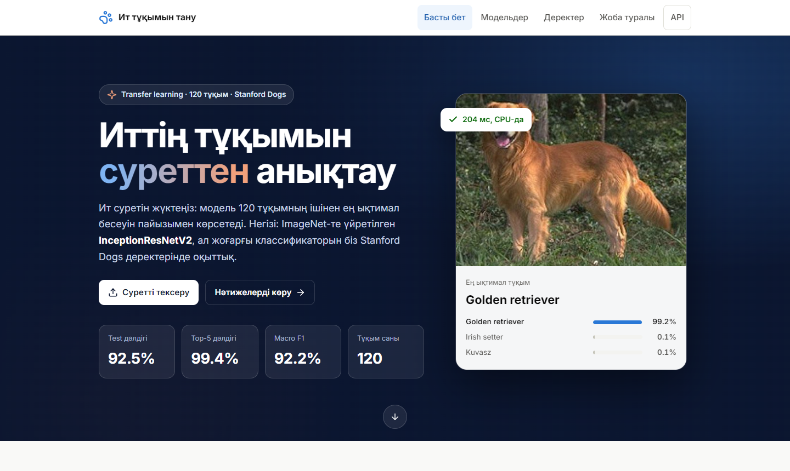

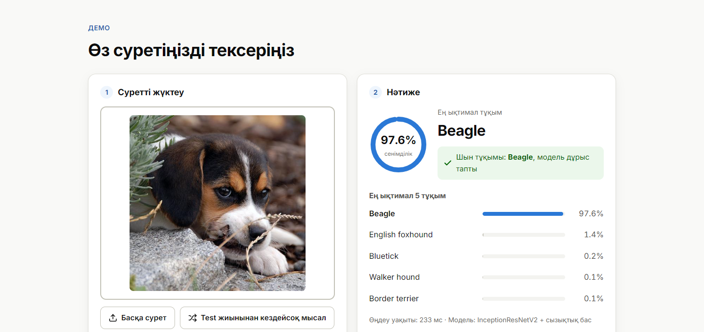

## Қысқаша нәтиже

| | Test (8 580 сурет) |
|---|---|
| **Таңдалған модель:** InceptionResNetV2 (мұздатылған) + сызықтық бас | **accuracy 92,5%**, top-5 99,4%, macro F1 92,2% |
| Мақаланы қайталау: InceptionResNetV2 + мақаладағы MLP басы | 90,8% (val 91,1%; мақалада val 90,2%) |
| Нөлден оқытылған CNN (baseline) | 8,1% |
| Кездейсоқ деңгей (ең жиі класс) | 0,6% |

## Мазмұны
1. [Мәселенің қойылымы](#1-мәселенің-қойылымы)
2. [Мақсат және міндеттер](#2-мақсат-және-міндеттер)
3. [Әдебиетке шолу](#3-әдебиетке-шолу)
4. [Деректер жиыны](#4-деректер-жиыны)
5. [Деректерді алдын ала өңдеу](#5-деректерді-алдын-ала-өңдеу)
6. [Әдістеме](#6-әдістеме)
7. [Модель таңдаудың негіздемесі](#7-модель-таңдаудың-негіздемесі)
8. [Оқыту процесі](#8-оқыту-процесі)
9. [Тестілеу тәсілі](#9-тестілеу-тәсілі)
10. [Бағалау метрикалары](#10-бағалау-метрикалары)
11. [Нәтижелер](#11-нәтижелер)
12. [Қателерді талдау](#12-қателерді-талдау)
13. [Қолданба: сайт және API](#13-қолданба-сайт-және-api)
14. [Шектеулер](#14-шектеулер)
15. [Болашақ даму бағыттары](#15-болашақ-даму-бағыттары)
16. [Пайдаланылған дереккөздер](#16-пайдаланылған-дереккөздер)
- [Іске қосу нұсқаулығы](#іске-қосу-нұсқаулығы) · [Жоба құрылымы](#жоба-құрылымы) · [Жеке үлес](#мақаладан-айырмашылығы-жеке-үлес)

---

## 1. Мәселенің қойылымы

Иттің тұқымын суреттен анықтау — **120 класты «ұсақ түйіршікті» (fine-grained) кескін жіктеу** міндеті. Тұқымдар бір-біріне өте ұқсас
(Siberian husky мен Eskimo dog, toy және miniature poodle), ал бір тұқымның ішінде түсі, жасы, позасы мен фоны әртүрлі.
Мұндай жүйе ветеринарлық қызметтерге, жоғалған жануарларды іздеу платформаларына, баспана каталогтарына қажет.
120 класты нөлден үйрету үшін өте көп сурет пен GPU керек. **Transfer learning** ImageNet-те үйренген білімді жаңа міндетке көшіру арқылы бұл мәселені шешеді.

## 2. Мақсат және міндеттер

**Мақсаты:** ит суретінен оның тұқымын (120 тұқымның бірін) анықтайтын, сапасы бірнеше метрикамен өлшенген және сайт арқылы қолжетімді модель жасау.
**Жетістік өлшемі** (алдын ала белгіленді): тәуелсіз test жиынында accuracy ≥ 85% және top-5 ≥ 97%. Нәтиже: **92,5% және 99,4%**, яғни мақсатқа жеттік.

**Міндеттер:**
1. Деректерді жүктеу, тексеру және тазалау (бұзылған файлдар, форматтар, көшірмелер, белгі қайшылықтары).
2. EDA: кластардың таралуы, сурет өлшемдері, аннотация бойынша иттің кадрдағы үлесі.
3. Бастапқы модельдер: кездейсоқ деңгей және нөлден оқытылған CNN.
4. Transfer learning: 3 алдын ала үйретілген модель × 3 классификатор, соның ішінде мақаладағы модель мен басты қайталау.
5. Барлық модельді бір test жиынында бірнеше метрикамен салыстыру. Соңғы модельді валидация бойынша таңдау.
6. Қателерді, калибрлеуді және шектеулерді талдау.
7. Модельмен байланысқан сайт пен API жасау.

## 3. Әдебиетке шолу

- **Stanford Dogs** (Khosla et al., 2011): ImageNet-тен құралған 120 тұқым, 20 580 сурет. Ұсақ түйіршікті жіктеудің классикалық эталоны.
  Авторлардың бастапқы нәтижесі (SIFT + SVM) ~22% дәлдік берген.
- **Kaggle «Dog Breed Identification»** (2017): Stanford Dogs-тың бір бөлігі. Үздік шешімдер ImageNet-те үйретілген
  CNN-дердің (Inception, Xception, InceptionResNetV2) белгілерін біріктірген. Яғни transfer learning бұл міндетте стандартты тәсіл.
- **Transfer learning** (Yosinski et al., 2014): CNN-нің төменгі қабаттары жалпы белгілерді (жиектер, текстуралар), ал жоғарғы қабаттары
  міндетке тән белгілерді үйренеді. Сондықтан ImageNet белгілері жаңа міндеттерге жақсы көшеді.
- **Архитектуралар:** InceptionResNetV2 (Szegedy et al., 2017), MobileNetV2 (Sandler et al., 2018), EfficientNet (Tan & Le, 2019).
- **GeeksforGeeks мақаласы:** мұздатылған InceptionResNetV2 + MLP басы, Kaggle деректері, валидация дәлдігі 90,2%. Бұл біздің бастапқы нүктеміз.
- **Калибрлеу** (Guo et al., 2017): заманауи нейрондық желілердің ықтималдықтары жиі тым сенімді. Сондықтан ECE өлшедік.

## 4. Деректер жиыны

- **Дереккөз:** [Stanford Dogs Dataset](http://vision.stanford.edu/aditya86/ImageNetDogs/) (ресми сайт), `scripts/00_download_data.py` арқылы жүктеледі.
  Мақаладағы Kaggle деректері осы жиынның бір бөлігі. Kaggle-дің test бөлігінде белгі жоқ, сондықтан тәуелсіз бағалау үшін толық, ресми жиын алынды.
- **Құрылымы:** 20 580 JPEG сурет, 120 тұқым (бір тұқымға 144–252 сурет). Әр суретке иттің орнын көрсететін аннотация (bounding box) берілген.
- **Белгілер (features):** RGB сурет, өлшемдері әртүрлі (ені 97–3264 px, медианасы 500×375 px).
- **Мақсатты айнымалы (target):** тұқым (120 класс).
- **Бөлініс:** ресми бөлініс сақталды. Ресми train-нен әр тұқымға 15 сурет валидацияға бөлінді.

| Бөлік | Сурет | Мақсаты |
|---|---|---|
| train | 10 070 | оқыту (теңестірілген: тұқымға 77–85 сурет) |
| val | 1 800 | гиперпараметр мен модельді таңдау |
| test | 8 580 | тек соңғы бағалау (теңестірілмеген: тұқымға 48–152 сурет) |

Толығырақ: [`notebooks/01_EDA.ipynb`](notebooks/01_EDA.ipynb), сайттағы «Деректер» беті.

## 5. Деректерді алдын ала өңдеу

`scripts/01_prepare_data.py` бойынша:
- **Жетіспейтін мәндер мен бұзылған файлдар:** жоқ (0).
- **Қате формат:** 1 файлдың кеңейтімі `.jpg`, бірақ іші PNG (RGBA). Ол RGB JPEG-ке айналдырылды.
- **Көшірмелер:** MD5 хэші мен dHash (кескіннің «саусақ ізі») арқылы 130 жуық көшірме жұбы табылды:
  - 39 train суреті test-тегі суреттің көшірмесі болды (**data leakage**), сондықтан олар train-нен алынды;
  - 34 сурет train ішінде қайталанған, әр топтан біреуі ғана қалдырылды;
  - **48 топта бірдей сурет екі түрлі тұқыммен белгіленген** (мысалы, Walker hound ↔ English foxhound). Мұндай 57 train суреті алынды, ал test ресми түрінде қалдырылды.
- **Сурет өлшемі:** әр модельдің кіріс өлшеміне келтіріледі (MobileNetV2/EfficientNetB0: 224×224, InceptionResNetV2: 299×299), antialias билинеар интерполяция.
- **Нормализация:** әр модельдің өз `preprocess_input` функциясы (InceptionResNetV2 үшін [-1, 1] ауқымы).
- **Кеңейту (augmentation):** мақаладағыдай көлденең айналдыру. Айналдырылған суреттердің белгілері train-ге қосылды.

## 6. Әдістеме

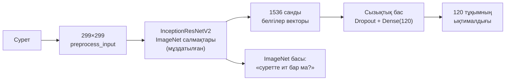

Алдын ала үйретілген желінің салмақтары **мұздатылады** (мақаладағыдай `trainable = False`). Мұздатылған желінің шығысы әр эпохада өзгермейді,
сондықтан әр суреттің белгілер векторын **бір рет есептеп сақтадық** (`scripts/02_extract_features.py`), ал классификаторды осы векторларда оқыттық.
Бұл мақаладағы тәсілмен математикалық тұрғыдан бірдей, бірақ GPU-сыз ноутбукта да оқыту секундтар алады.

Ең ауыр модель InceptionResNetV2 белгілері Intel Iris Xe графикалық чипінде **OpenVINO** арқылы есептелді (FP32: TensorFlow-пен айырмасы ~2·10⁻⁶,
болжамдар 100% сәйкес). Сайттың өзі TensorFlow-да жұмыс істейді.

## 7. Модель таңдаудың негіздемесі

| Модель | Неге таңдалды |
|---|---|
| Ең жиі класс | кездейсоқ деңгейді көрсету үшін |
| Нөлден оқытылған CNN | transfer learning-сіз не мүмкін екенін көрсету үшін (baseline) |
| MobileNetV2 (2,3 млн параметр) | жылдам, мобильді құрылғыларға арналған |
| EfficientNetB0 (4,0 млн) | дәлдік пен жылдамдықтың жақсы келісімі |
| InceptionResNetV2 (54,3 млн) | мақалада қолданылған модель, ең дәл |
| Мақаладағы MLP басы | мақаланы қайталау үшін |
| Сызықтық бас (Dropout + Dense) | белгілер онсыз да күшті, параметрі аз модель шамадан тыс аз үйренеді |
| LogisticRegression | классикалық ML әдісімен салыстыру |
| ImageNet басы, оқытусыз | ImageNet-пен қиылысуды тексеру үшін (тек салыстыру) |

## 8. Оқыту процесі

| Модель | Баптаулар |
|---|---|
| Мақаладағы MLP басы | BatchNorm → Dense(512) → Dense(256) → Dropout(0,5) → Dense(128) → Dense(120); Adam 1e-3, batch 32, ≤ 25 эпоха, EarlyStopping(patience = 10) |
| Сызықтық бас | Dropout(0,5) → Dense(120, L2 = 1e-4); Adam 1e-3, batch 64, ≤ 60 эпоха, EarlyStopping(patience = 8), ReduceLROnPlateau |
| LogisticRegression | StandardScaler + LogisticRegression, C ∈ {0,03; 0,3} (val log loss бойынша таңдалды: C = 0,03) |
| Нөлден оқытылған CNN | 4 × [Conv3×3 → BatchNorm → ReLU → MaxPool] → GAP → Dropout → Dense(120); 64×64 кесінді, айналдыру; Adam 1e-3, 12 эпоха |

Барлық кездейсоқтық `SEED = 42` арқылы бекітілген. Оқу қисықтары мен тарихы: `artifacts/histories/`, графигі: `reports/figures/training_curves.png`.
**Сәтсіз тәжірибелер де тіркелді:** мақаладағы MLP басы 2-эпохадан кейін шамадан тыс үйренеді, ал 112 px-тегі CNN CPU-да тым баяу болды (бір эпоха ~6 мин), сондықтан 64 px-ке ауыстырылды.

## 9. Тестілеу тәсілі

- Гиперпараметрлер мен соңғы модель тек **val** бойынша таңдалды. **Test** (8 580 сурет) тек соңғы бағалауға бір рет қолданылды.
- Барлық модель **бірдей** train/val/test бөлінісінде бағаланды.
- **TTA** (test-time augmentation): суреттің өзі мен айналдырылған нұсқасының болжамын орташалау. Жеңіл модельдер үшін тексерілді.
- Сайттың болжамы скрипттегі болжаммен бірдей екені тексерілді (экспорттан кейін val болжамдарымен айырма = 0).

## 10. Бағалау метрикалары

| Метрика | Нені өлшейді |
|---|---|
| Accuracy | дұрыс анықталған суреттердің үлесі |
| Top-5 accuracy | дұрыс тұқым алғашқы 5 болжамның ішінде ме (ұқсас тұқымдар көп болғандықтан маңызды) |
| Macro precision / recall / F1 | әр тұқым бойынша орташа, барлық тұқым тең салмақпен (test теңестірілмеген) |
| Log loss | ықтималдықтардың сапасы: қате жауапқа сенімді болу қатаң жазаланады |
| ECE | калибрлеу қатесі: «90% сенімдімін» деген болжамдардың шынымен ~90%-ы дұрыс па |

## 11. Нәтижелер

| Модель | Test acc. | Top-5 | Macro F1 | Log loss | Val acc. | Параметр, млн | CPU уақыты |
|---|---|---|---|---|---|---|---|
| Ең жиі класс (кездейсоқ деңгей) | 0,6% | 5,1% | 0,0% | 4,786 | 0,8% | — | — |
| Нөлден оқытылған CNN (baseline) | 8,1% | 28,1% | 6,3% | 4,032 | 8,2% | 0,4 | 5 мс |
| MobileNetV2 + мақаладағы MLP басы | 77,1% | 96,2% | 75,7% | 0,796 | 75,9% | 3,1 | 31 мс |
| MobileNetV2 + сызықтық бас | 82,6% | 98,0% | 81,9% | 0,552 | 82,1% | 2,4 | 31 мс |
| MobileNetV2 + LogisticRegression + TTA | 84,6% | 98,2% | 83,9% | 0,505 | 84,3% | 2,3 | 61 мс |
| EfficientNetB0 + мақаладағы MLP басы | 77,3% | 96,7% | 75,8% | 0,741 | 77,1% | 4,9 | 57 мс |
| EfficientNetB0 + сызықтық бас + TTA | 85,5% | 98,5% | 84,8% | 0,497 | 85,2% | 4,2 | 113 мс |
| InceptionResNetV2 + мақаладағы MLP басы (**мақаланы қайталау**) | 90,8% | 98,6% | 90,0% | 0,419 | 91,1% | 55,3 | 204 мс |
| InceptionResNetV2 + LogisticRegression | 91,6% | 99,2% | 91,2% | 0,296 | 91,4% | 54,3 | 204 мс |
| **InceptionResNetV2 + сызықтық бас (таңдалды)** | **92,5%** | **99,4%** | **92,2%** | **0,249** | **92,2%** | 54,5 | 204 мс |
| *InceptionResNetV2: ImageNet басы, оқытусыз (салыстыру үшін)* | *92,6%* | *99,7%* | *92,1%* | *0,239* | *92,1%* | *54,3* | *204 мс* |

Толық кесте (21 модель): [`reports/metrics/comparison.csv`](reports/metrics/comparison.csv). CPU уақыты: бір сурет, TensorFlow, Intel i7-1255U.

**Таңдалған модельдің толық көрсеткіштері (test):** accuracy 92,5%, top-5 99,4%, macro precision 92,2%, macro recall 92,3%,
macro F1 92,2%, weighted F1 92,5%, log loss 0,249, ECE 0,012 (жақсы калибрленген).

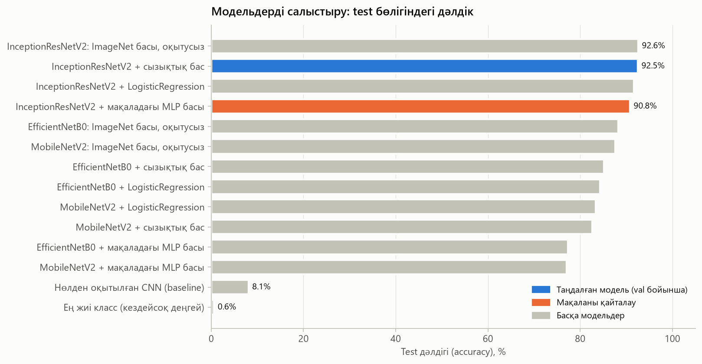

**Негізгі қорытындылар:**
1. **Transfer learning шешуші рөл атқарады:** нөлден оқытылған CNN 8,1%, ал сол деректерде мұздатылған InceptionResNetV2 + қарапайым бас 92,5% берді.
2. **Мақаланың нәтижесі расталды:** мақаладағы модель мен бас валидацияда 91,1% (мақалада 90,2%).
3. **Қарапайым бас жақсырақ:** сызықтық бас мақаладағы MLP-ден дәлірек (92,5% / 90,8%) және ықтималдықтары шынайырақ (log loss 0,249 / 0,419).
   MLP шамадан тыс үйренеді: val loss 2-эпохадан кейін өседі.
4. **Үлкен модель дәлірек, бірақ баяу:** MobileNetV2 31 мс / 82–85%, InceptionResNetV2 204 мс / 92,5%.
5. **ImageNet-пен қиылысу:** ImageNet басы еш оқытусыз 92,6% береді. Бұл ImageNet-те осы тұқымдар (және суреттер) бар екенін көрсетеді (14-бөлімді қараңыз).

| | |
|---|---|
| 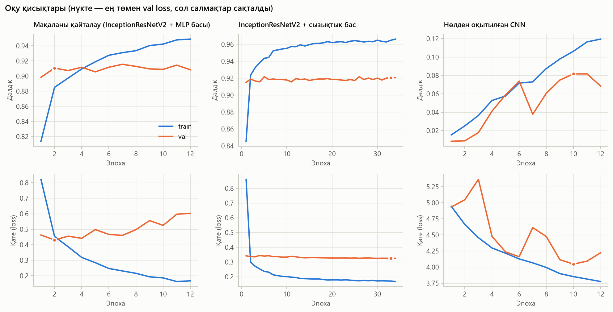 | 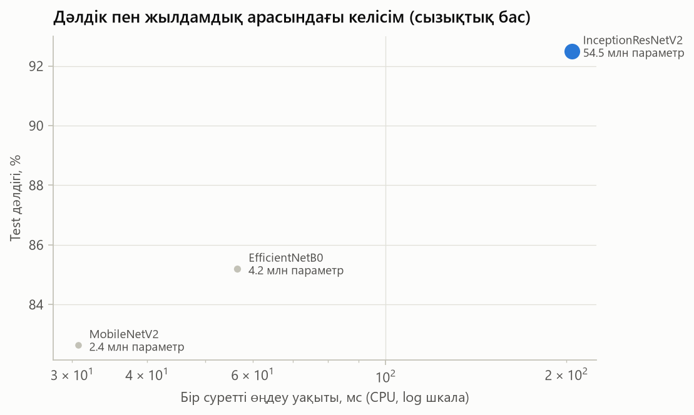 |

## 12. Қателерді талдау

- **Ұқсас тұқымдар:** ең жиі қателер (test): Siberian husky ↔ Eskimo dog (43), Scottish deerhound ↔ Irish wolfhound (22), Lhasa ↔ Shih-Tzu (21),
  Staffordshire bullterrier ↔ American Staffordshire terrier (18), toy ↔ miniature poodle (13), Collie → Border collie (11).
  Ең нашар танылатын тұқым: Eskimo dog (F1 = 0,46).
- **Иттің кадрдағы өлшемі:** ит кадрдың 10%-ынан азын алса, дәлдік **79,8%**, ал 50–75%-ын алса, **93,7%**. Ит санының әсері жоқ дерлік (1 ит: 92,5%, 2 ит: 92,1%).
- **Сенімділік:** сенімділігі 50%-дан жоғары болжамдар (97,7%) 93,7% дұрыс, ал 50%-дан төмендері небәрі 42,3% дұрыс. Сондықтан сайт мұндай жағдайда ескерту береді.
- **Белгі қателері:** модель «сенімді түрде қателескен» кейбір суреттерде белгінің өзі күмәнді (деректерде бірдей сурет екі тұқыммен белгіленген жағдайлар бар).

| | |
|---|---|
| 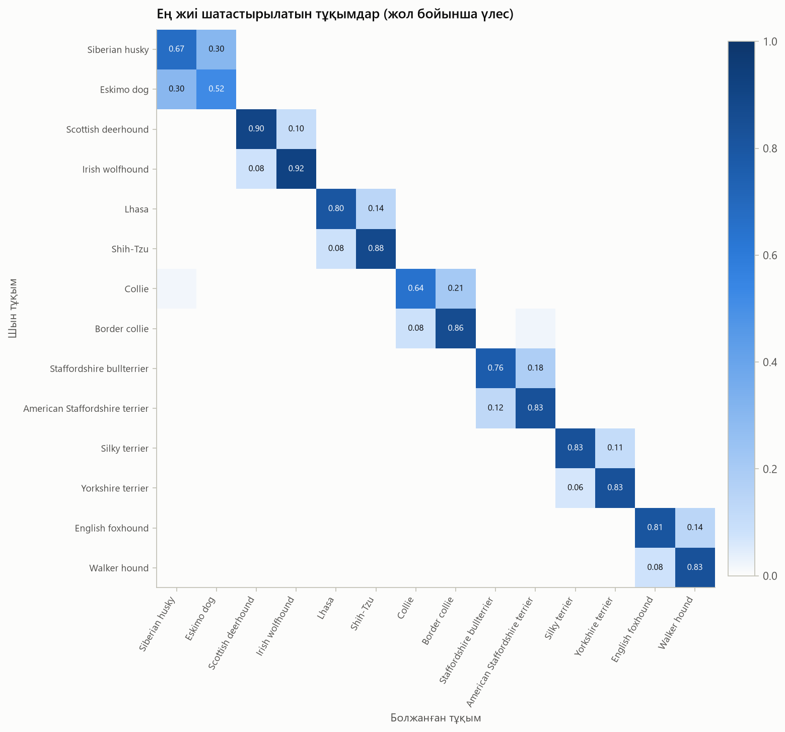 | 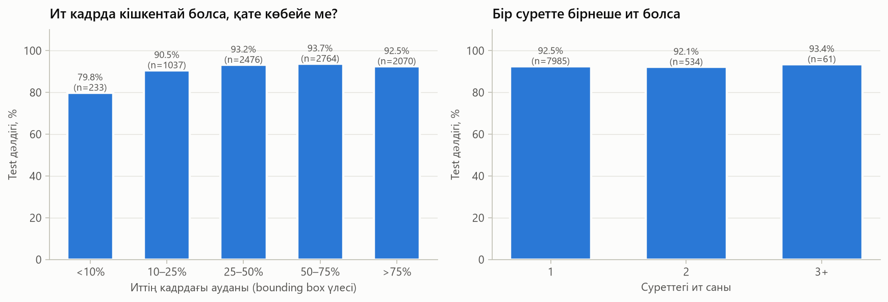 |

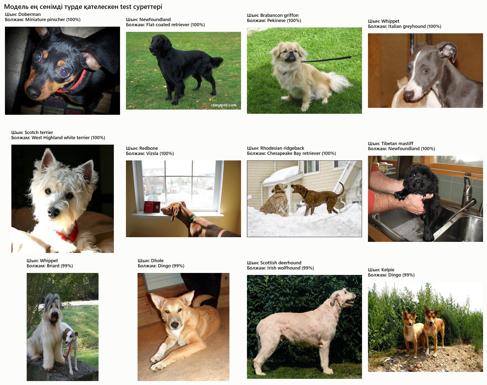

## 13. Қолданба: сайт және API

Сайт **FastAPI + Jinja2 + HTML/CSS/JS** арқылы жасалған (қазақ тілінде). Сервер іске қосылғанда модельді бір рет жүктейді.
Анимациялар: **GSAP** (ScrollTrigger: элементтердің біртіндеп пайда болуы, сандарды санау, нәтиже индикаторы) және
**Vanta.js** (three.js негізіндегі «нейрондық желі» фоны). Кітапханалар `web/static/vendor/` ішінде жергілікті сақталған, сондықтан сайт интернетсіз де жұмыс істейді.
`prefers-reduced-motion` баптауы ескеріледі, ал әлсіз компьютерде (FPS < 20) фон анимациясы өздігінен өшеді.

| Бет | Мазмұны |
|---|---|
| `/` Басты бет | мысал суреттер галереясы (бір басумен тексеру), суретті жүктеу (батырма, сүйреп әкелу, Ctrl+V), test жиынынан кездейсоқ мысал, сенімділік индикаторы мен top-5 тұқым, ескертулер |
| `/models` Модельдер | салыстыру кестесі, графиктер, қателерді талдау |
| `/data` Деректер | деректер жиыны, тазалау нәтижесі, EDA графиктері |
| `/about` Жоба туралы | мақсат, әдістеме, шектеулер, дереккөздер |
| `/docs` | API құжаттамасы (Swagger) |

**API:** `POST /api/predict` (multipart `file`) → JSON:
```json
{"top": [{"breed": "Golden retriever", "prob": 0.978, "label": 56}, ...],
 "dogness": 0.88, "is_dog": true, "low_confidence": false, "inference_ms": 272, "model": "InceptionResNetV2 + сызықтық бас"}
```
Басқа эндпоинттер: `GET /api/random-test`, `GET /api/models`, `GET /api/health`.

**Қорғаныс механизмдері:** (1) ImageNet басы бойынша «ит» кластарының қосынды ықтималдығы 50%-дан аз болса, «суретте ит анықталмады» ескертуі;
(2) ең жоғары ықтималдық 50%-дан аз болса, «модель сенімсіз» ескертуі. Демо үшін `http://127.0.0.1:8000/?example=1` бет ашылғанда кездейсоқ мысалды көрсетеді.

| | |
|---|---|
| 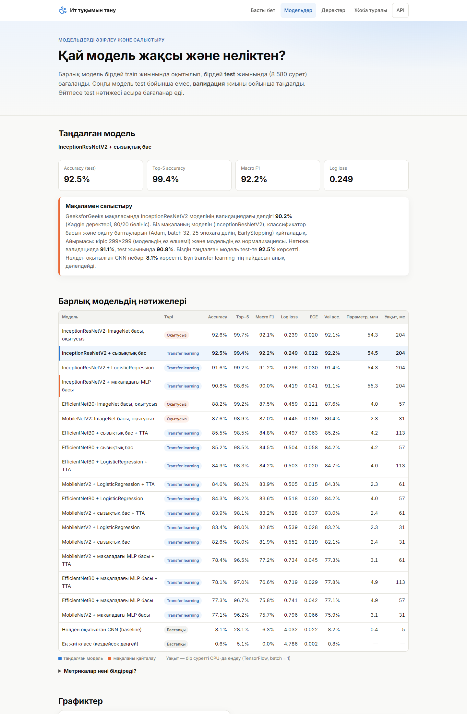 | 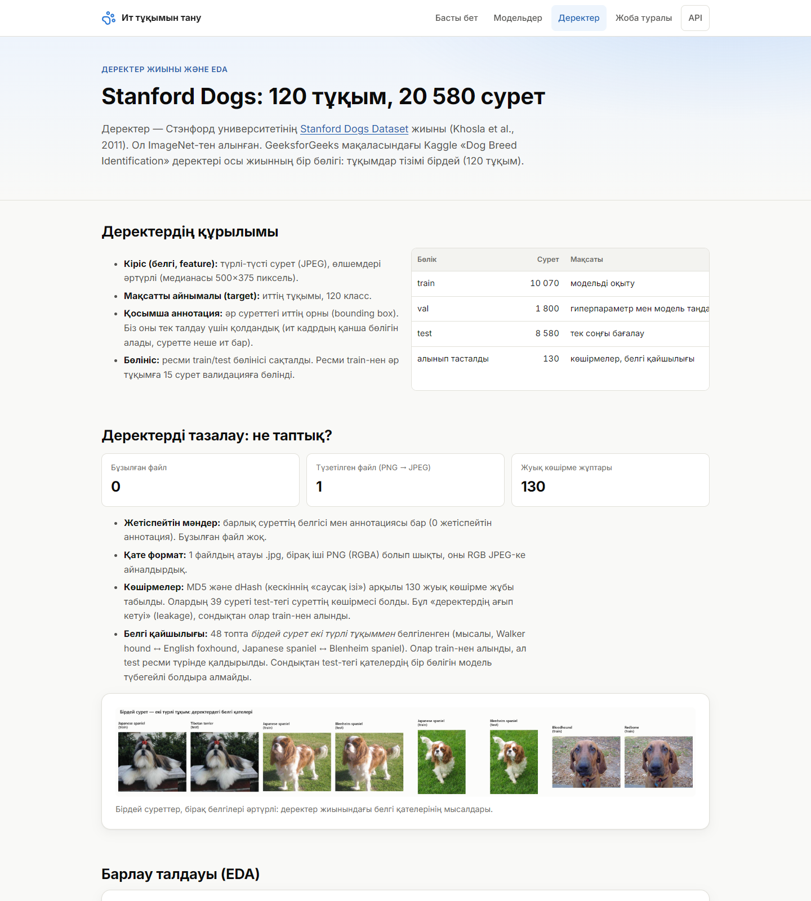 |

## 14. Шектеулер

- **Тек 120 тұқым.** Аралас тұқымдар, басқа жануарлар немесе адам суреті үшін модель бәрібір бір тұқымды атайды (ескертулер осы үшін).
- **ImageNet-пен қиылысу.** Stanford Dogs суреттері ImageNet-тен алынған, ал алдын ала үйретілген модель ImageNet-те оқыған. Сондықтан test нәтижесі
  нақты өмірдегі жаңа суреттерге қарағанда оптимистік болуы мүмкін.
- **Деректердегі белгі қателері:** бір сурет екі тұқыммен белгіленген жағдайлар бар. Олар test-те қалды.
- **Кішкентай иттер:** ит кадрдың 10%-ынан азын алса, дәлдік ~80%-ға түседі.
- **Жылдамдық:** InceptionResNetV2 CPU-да бір суретке ~0,2–0,3 с жұмсайды. MobileNetV2 7 есе жылдам, бірақ ~8–10 пайыздық тармаққа нашар.

## 15. Болашақ даму бағыттары

- GPU-да fine-tuning (желінің жоғарғы блоктарын да оқыту); заманауи архитектуралар (EfficientNetV2, ConvNeXt, ViT).
- Итті алдымен объект детекторымен (мысалы, YOLO) тауып, қиып алу (кішкентай иттер үшін).
- ImageNet-ке кірмеген тәуелсіз суреттерде тексеру (мысалы, Қазақстандағы баспаналардың суреттері).
- Тұқым атауларын қазақ тіліне аудару, мобильді нұсқа (TensorFlow Lite), ықтималдықтарды калибрлеу (temperature scaling).
- Мақаланың дәл баптауларын (331×331, пиксель/255) тексеру: код дайын (`irv2_article`), бірақ CPU-да ~2 сағат алатындықтан іске қосылмады.

## 16. Пайдаланылған дереккөздер

1. GeeksforGeeks. [Multiclass image classification using Transfer learning](https://www.geeksforgeeks.org/deep-learning/multiclass-image-classification-using-transfer-learning/), 2024.
2. Khosla A., Jayadevaprakash N., Yao B., Fei-Fei L. *Novel Dataset for Fine-Grained Image Categorization: Stanford Dogs.* CVPR Workshop on FGVC, 2011.
3. Kaggle. [Dog Breed Identification](https://www.kaggle.com/c/dog-breed-identification), 2017.
4. Deng J. et al. *ImageNet: A Large-Scale Hierarchical Image Database.* CVPR, 2009.
5. Szegedy C. et al. *Inception-v4, Inception-ResNet and the Impact of Residual Connections on Learning.* AAAI, 2017.
6. Sandler M. et al. *MobileNetV2: Inverted Residuals and Linear Bottlenecks.* CVPR, 2018.
7. Tan M., Le Q. *EfficientNet: Rethinking Model Scaling for Convolutional Neural Networks.* ICML, 2019.
8. Yosinski J. et al. *How transferable are features in deep neural networks?* NeurIPS, 2014.
9. Guo C. et al. *On Calibration of Modern Neural Networks.* ICML, 2017.
10. [Keras Applications](https://keras.io/api/applications/), [FastAPI](https://fastapi.tiangolo.com/), [OpenVINO](https://docs.openvino.ai/) құжаттамалары.

---

## Іске қосу нұсқаулығы

Талаптар: Python 3.11–3.13, ~3 ГБ бос орын (деректер + кітапханалар). GPU міндетті емес.
> **Windows ескертуі:** жобаны қысқа жолы бар қалтаға қойыңыз (мысалы `C:\projects\dog-breed-classifier`).
> Жол тым ұзын болса (260 таңбадан артық), TensorFlow DLL файлдары жүктелмейді.

**1. Орта**
```powershell
python -m venv .venv
.\.venv\Scripts\python -m pip install -r requirements.txt
```

**2. Тек сайтты іске қосу** (дайын модель `models/final/` ішінде; ImageNet салмақтары бірінші іске қосқанда автоматты жүктеледі, ~220 МБ)
```powershell
.\.venv\Scripts\python -m uvicorn web.main:app --port 8000
```
Браузерде: http://127.0.0.1:8000 (API құжаттамасы: http://127.0.0.1:8000/docs).
«Test жиынынан кездейсоқ мысал» батырмасы үшін деректер жүктелген болуы керек (3-қадам).

**3. Барлық нәтижені қайталау** (деректерді жүктеу → тазалау → белгілер → оқыту → бағалау; CPU-да бірнеше сағат)
```powershell
.\run_all.ps1
```
Немесе қадамдап: `scripts/00_download_data.py` → `01_prepare_data.py` → `01b_eda.py` → `02_extract_features.py` →
`03_train_baseline_cnn.py` → `04_train_heads.py` → `05_benchmark_latency.py` → `06_evaluate.py` (әрқайсысын `python -I scripts/...` арқылы).
Intel GPU болса, жылдамдату үшін: `pip install openvino`, сосын `02_extract_features.py ... --device GPU`.

**4. Ноутбуктар:** `notebooks/01_EDA.ipynb` (деректерді талдау) және `notebooks/02_Modeling_and_Evaluation.ipynb`
(модельдер, мақаланы ноутбук ішінде қайталау, қателерді талдау). Екеуі де нәтижелерімен сақталған.
```powershell
.\.venv\Scripts\python -m jupyter notebook notebooks
```

## Жоба құрылымы

```
dog-breed-classifier/
├── data/processed/          splits.csv (бөлініс), data_quality.json (тазалау нәтижесі)
├── docs/                    defense_QA.md (қорғауға дайындық), presentation.pptx, screenshots/
├── models/final/            сайттағы модель: head.keras, labels.json, model_info.json
├── notebooks/               01_EDA.ipynb, 02_Modeling_and_Evaluation.ipynb
├── reports/figures/         барлық графиктер (EDA, салыстыру, қателер)
├── reports/metrics/         comparison.csv, final_model.json, per_class.csv, confused_pairs.csv, summary.json
├── scripts/                 00–06: деректерден бастап бағалауға дейінгі қадамдар
├── src/                     config, деректер, модельдер (backbones, heads), метрикалар, EDA, болжау (inference)
├── web/                     main.py (FastAPI), templates/ (беттер), static/ (CSS, JS, vendor/: GSAP, three.js, Vanta; examples/: мысал суреттер)
├── requirements.txt
└── run_all.ps1              бүкіл pipeline
```
Үлкен файлдар (деректер, белгілер, барлық эксперимент модельдері) `.gitignore` арқылы репозиторийге кірмейді. Олар скрипттер арқылы қайта жасалады.

## Мақаладан айырмашылығы (жеке үлес)

| Аспект | Мақалада | Бұл жобада |
|---|---|---|
| Деректер | Kaggle, 10 222 сурет, test белгісіз | ресми Stanford Dogs, 20 580 сурет, тәуелсіз test |
| Деректер сапасы | тексерілмеген | 130 көшірме, 39 leakage, 48 белгі қайшылығы табылып, тазаланды |
| Модельдер | бір модель | baseline (2) + 3 backbone × 3 бас + оқытусыз ImageNet басы |
| Бағалау | train/val accuracy | test: accuracy, top-5, macro F1, log loss, ECE, қателер мен калибрлеу талдауы |
| Оқыту | Colab GPU | GPU-сыз: белгілерді кэштеу + OpenVINO (Intel GPU) |
| Нәтиже | ноутбук | сайт + REST API, құжатталған репозиторий |

**Сыртқы код пен ресурстар:** Keras Applications (дайын архитектуралар мен ImageNet салмақтары), мақаладағы классификатор басының архитектурасы.
Деректерді тазалау, эксперименттер, бағалау және сайт осы жоба аясында жазылды.

## Авторлар

[Аты-жөні], [топ]: машиналық оқыту пәні, қорытынды жоба.
